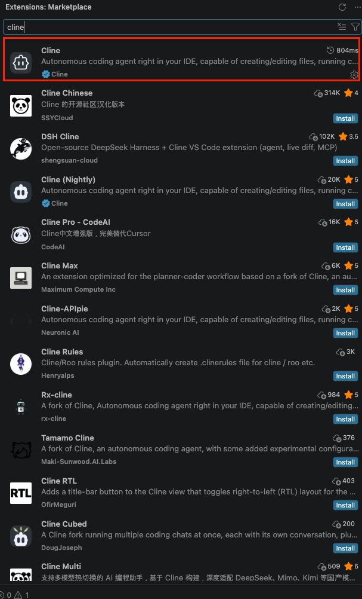
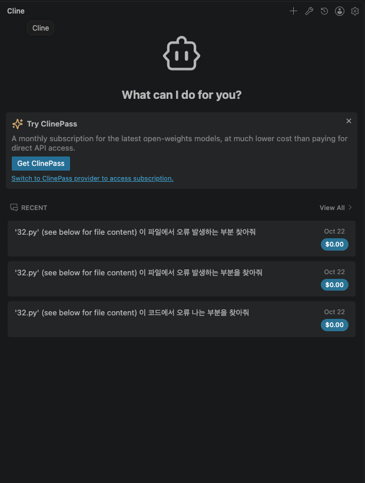
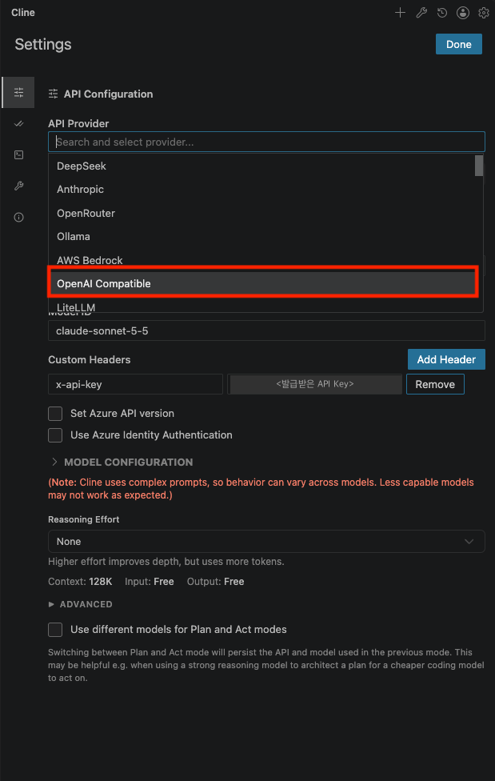
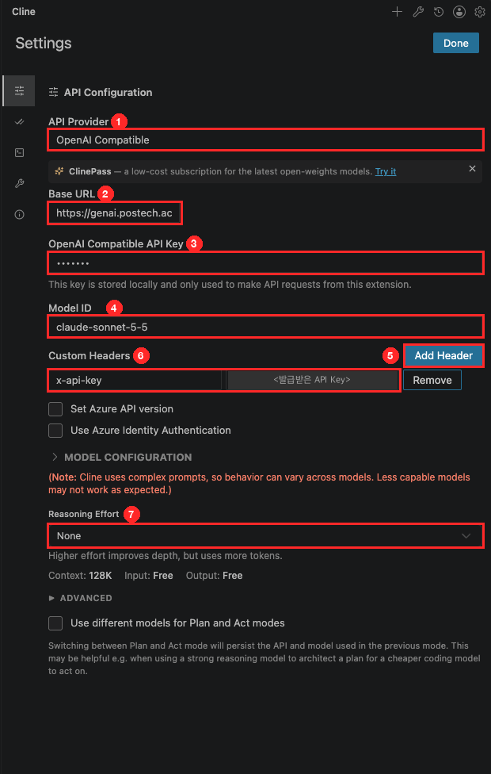

# POSTECH OpenAI Compatible API 사용 가이드

POSTECH OpenAI Compatible API를 **VSCode Cline 확장**과 **코드(curl / Python)**에서 사용하는 방법을 정리한 문서입니다.

## 목차

1. [사전 준비](#1-사전-준비)
2. [Cline 설치 및 설정](#2-cline-설치-및-설정)
3. [사용 가능 모델](#3-사용-가능-모델)
4. [API 직접 호출 (curl / Python)](#4-api-직접-호출-curl--python)
5. [참고: OpenAI 호환 API의 벤더 고유기능 누락](#5-참고-openai-호환-api의-벤더-고유기능-누락)

---

## 1. 사전 준비

| 항목       | 내용                                                              |
| ---------- | ----------------------------------------------------------------- |
| VSCode     | 최신 버전 권장                                                    |
| API Key    | POSTECH GenAI에서 발급받은 개인 API Key (`x-api-key` 헤더로 전달) |
| 엔드포인트 | OpenAI 호환 Chat Completions (`/chat/completions`)                |

> ⚠️ API Key는 개인 자격증명입니다. 스크린샷·코드·저장소에 노출되지 않도록 주의하세요.

---

## 2. Cline 설치 및 설정

### Step 1. Cline 확장 설치

1. VSCode 좌측 **Extensions(확장)** 탭 열기 (`Cmd+Shift+X` / `Ctrl+Shift+X`)
2. `cline` 검색
3. 게시자가 **Cline (인증 마크)** 인 항목 설치
   - `Cline Chinese`, `Cline (Nightly)` 등 유사 확장과 혼동 주의



### Step 2. Cline 패널 열기

- 설치 후 좌측 Activity Bar의 **Cline 아이콘** 클릭
- 우측 상단 **⚙️(Settings)** 아이콘 클릭 → 설정 화면 진입



### Step 3. API Provider 선택

- **API Provider** 드롭다운에서 **`OpenAI Compatible`** 선택



### Step 4. API 설정 입력

아래 이미지의 번호 순서대로 입력합니다.



| #   | 항목                            | 입력값                                                       | 비고                                        |
| --- | ------------------------------- | ------------------------------------------------------------ | ------------------------------------------- |
| ①   | API Provider                    | `OpenAI Compatible`                                          | Step 3에서 선택                             |
| ②   | Base URL                        | `https://genai.postech.ac.kr/agent/openai_compatible/a1/v1`  | `/chat/completions`는 붙이지 않음           |
| ③   | OpenAI Compatible API Key       | `postech`                                                    | 임의 값 입력 (실제 인증에는 사용되지 않음)  |
| ④   | Model ID                        | 예: `claude-sonnet-5-5`                                      | [3. 사용 가능 모델](#3-사용-가능-모델) 참고 |
| ⑤   | Custom Headers → **Add Header** | 버튼 클릭                                                    | 헤더 입력 행 추가                           |
| ⑥   | Custom Header 값                | 왼쪽: `x-api-key` / 오른쪽: `발급받은 API Key`               | **실제 인증은 이 헤더로 처리**              |
| ⑦   | Reasoning Effort                | `None`                                                       |                                             |

입력 완료 후 우측 상단 **Done** 클릭 → 채팅창에서 테스트 메시지를 보내 응답을 확인합니다.

> 💡 ③ API Key 칸은 비워두면 Cline이 저장을 막기 때문에 아무 값(`postech`)이나 넣습니다. 인증은 ⑥ `x-api-key` 헤더가 담당합니다.

---

## 3. 사용 가능 모델

Cline의 **Model ID**(④)에 아래 모델명을 그대로 입력합니다.

| 제공사    | 모델 ID                  | Cline 사용 | 비고                                             |
| --------- | ------------------------ | ---------- | ------------------------------------------------ |
| OpenAI    | `gpt-6.1-sol`            | ❌         | 추론 모델은 OpenAI Compatible 모드에서 사용 불가 |
| OpenAI    | `gpt-6-astra`            | ❌         | 추론 모델은 OpenAI Compatible 모드에서 사용 불가 |
| OpenAI    | `gpt-6-luna`             | ❌         | 추론 모델은 OpenAI Compatible 모드에서 사용 불가 |
| OpenAI    | `gpt-5.6-terra`          | ✅         |                                                  |
| Anthropic | `claude-sonnet-5-5`      | ✅         |                                                  |
| Anthropic | `claude-opus-5-5`        | ✅         |                                                  |
| Anthropic | `claude-haiku-5-5`       | ✅         |                                                  |
| Gemini    | `gemini-3.8-flash`       | ✅         |                                                  |
| Gemini    | `gemini-3.1-pro-preview` | ⚠️         | Cline에서 에러 발생                              |

> Cline에서 사용 불가한 모델도 아래 **API 직접 호출** 방식으로는 사용할 수 있습니다. ([4-2. Python](#4-2-python-requests) 예제가 `gpt-6.1-sol` 호출)

### 제공사별 OpenAI 호환 API 공식 문서

POSTECH 게이트웨이는 각 제공사의 OpenAI 호환 API를 경유하므로, 지원 필드·제약은 아래 공식 문서를 기준으로 확인합니다. 요약은 [5장](#5-참고-openai-호환-api의-벤더-고유기능-누락) 참고.

| 제공사    | 공식 문서                                                                                                                      | 제공사 원본 Base URL                                        |
| --------- | ------------------------------------------------------------------------------------------------------------------------------ | ----------------------------------------------------------- |
| OpenAI    | [Chat Completions API Reference](https://platform.openai.com/docs/api-reference/chat) (기준 포맷)                              | `https://api.openai.com/v1/`                                |
| Anthropic | [OpenAI SDK compatibility](https://platform.claude.com/docs/en/cli-sdks-libraries/libraries/openai-sdk)                        | `https://api.anthropic.com/v1/`                             |
| Gemini    | [OpenAI compatibility](https://ai.google.dev/gemini-api/docs/openai)                                                           | `https://generativelanguage.googleapis.com/v1beta/openai/` |

> 위 Base URL은 제공사에 직접 호출할 때의 주소입니다. POSTECH API 사용 시에는 POSTECH 엔드포인트와 `x-api-key`를 사용합니다.

---

## 4. API 직접 호출 (curl / Python)

- Endpoint: `https://genai.postech.ac.kr/agent/openai_compatible/a1/v1/chat/completions`
- 인증 헤더: `x-api-key: {API_KEY}`
- 요청/응답 포맷: OpenAI Chat Completions 호환

### 4-1. curl (스트리밍)

```bash
curl --location 'https://genai.postech.ac.kr/agent/openai_compatible/a1/v1/chat/completions' \
--header 'x-api-key: {API_KEY}' \
--header 'Content-Type: application/json' \
--data '{
  "model": "claude-sonnet-5-5",
  "messages": [
    {
      "role": "user",
      "content": "나는 robiG 야. 내이름을 기억해"
    }
  ],
  "stream": true
}'
```

### 4-2. Python (`requests`)

```python
import requests
import json

# ==========================================
# POSTECH GenAI API 설정
# ==========================================

BASE_URL = "https://genai.postech.ac.kr/agent/openai_compatible/a1/v1"
X_API_KEY = ""  # 발급받은 API Key 입력
HEADERS = {
    "X-Api-Key": f"{X_API_KEY}",
    "Content-Type": "application/json"
}

# ==========================================
# GPT 모델 호출
# ==========================================

payload = {
    "model": "gpt-6.1-sol",
    "messages": [
        {
            "role": "user",
            "content": "안녕하세요. 간단히 자기소개해 주세요."
        }
    ],
    "stream": False
}

response = requests.post(
    f"{BASE_URL}/chat/completions",
    headers=HEADERS,
    json=payload,
    timeout=60
)

print("HTTP Status:", response.status_code)

try:
    result = response.json()
    print(json.dumps(result, indent=2, ensure_ascii=False))

    if response.status_code == 200 and "choices" in result:
        print("\n✅ OpenAI Compatible API 정상 작동")
        print("AI 응답:", result["choices"][0]["message"]["content"])
    else:
        print("\n❌ API 응답 확인 필요")

except Exception as e:
    print("오류:", e)
    print(response.text)
```

실행: 위 코드를 `llm.py`로 저장한 뒤 `pip install requests && python llm.py`

---

## 5. 참고: OpenAI 호환 API의 벤더 고유기능 누락

POSTECH 게이트웨이는 OpenAI 호환 포맷으로 Anthropic / Gemini 모델을 제공합니다. 이 경우 **각 벤더 고유기능 일부가 동작하지 않거나 조용히 무시**됩니다.

- 작성일: 2026-10-20
- 출처
  - Anthropic: [OpenAI SDK compatibility](https://platform.claude.com/docs/en/cli-sdks-libraries/libraries/openai-sdk)
  - Gemini: [OpenAI compatibility](https://ai.google.dev/gemini-api/docs/openai)
- 표기
  - ✅명시: 공식 문서에 직접 기재된 내용
  - ⚠️추론: 문서에 언급이 없어 미지원으로 추정 → **실제 호출로 검증 필요**

> Anthropic 문서는 미지원/무시 필드를 표로 명시하지만, Gemini 문서는 "현재 베타" 외에 누락 목록이 없다.
> 따라서 Gemini 항목 상당수는 "네이티브 API 기능 중 호환 문서에 없는 것" 기준으로 정리했다.

### 5-1. Anthropic (Claude) OpenAI 호환 API

> 공식 문서: [OpenAI SDK compatibility](https://platform.claude.com/docs/en/cli-sdks-libraries/libraries/openai-sdk)
> 공식 포지션: "테스트·비교용, 장기/프로덕션 솔루션으로 간주하지 않음"
> Base URL: `https://api.anthropic.com/v1/` / Rate limit은 `/v1/messages` 표준 한도를 따름

#### Claude 고유기능 누락

| 기능                                                   | 상태                                                                                               | 근거   |
| ------------------------------------------------------ | -------------------------------------------------------------------------------------------------- | ------ |
| **Prompt Caching**                                     | 미지원 (Anthropic SDK에서만 지원)                                                                  | ✅명시 |
| **PDF 처리** (document 블록)                           | 미지원 — `type: "file"` 입력 무시                                                                  | ✅명시 |
| **Citations**                                          | 미지원 (네이티브 API 권장 기능으로 명시)                                                           | ✅명시 |
| **Thinking 결과 반환**                                 | Claude 5 모델은 기본 활성(adaptive)이나 **응답에 thinking 미포함**, summarized thinking 미지원     | ✅명시 |
| **Structured Outputs**                                 | `response_format`, tool `strict` 무시 → 스키마 준수 보장 없음                                      | ✅명시 |
| **Mid-conversation system 메시지**                     | 모든 system/developer 메시지를 `\n`으로 이어 붙여 최상단 `system`으로 hoisting                     | ✅명시 |
| **effort 제어**                                        | `reasoning_effort` 무시                                                                            | ✅명시 |
| **Usage 상세** (캐시 토큰 등)                          | `prompt_tokens_details`, `completion_tokens_details` 항상 빈 값                                    | ✅명시 |
| Server tools (web search / web fetch / code execution) | 언급 없음                                                                                          | ⚠️추론 |
| MCP connector, Computer use, Memory tool               | 언급 없음                                                                                          | ⚠️추론 |
| Files API, Message Batches, Token counting             | Chat Completions만 대상, 그 외 엔드포인트 언급 없음                                                | ⚠️추론 |
| Context management / compaction, beta 헤더 기능        | 언급 없음                                                                                          | ⚠️추론 |

#### OpenAI 필드 무시·제약

- **무시(Ignored)**: `logprobs`, `top_logprobs`, `seed`, `presence_penalty`, `frequency_penalty`, `logit_bias`, `prediction`, `service_tier`, `store`, `metadata`, `user`, `modalities`, `audio`, 이미지 `detail`, `input_audio`
- **제약**
  - `n`: 반드시 1
  - `temperature`: 0~1 (1 초과 시 1로 cap). Claude 4.7 이상은 1 미만 값 → 400
  - `top_p`: Claude 4.7 이상은 0.99 외 값 → 400. `temperature`와 동시 지정 시 400
  - `stop`: 공백이 아닌 stop sequence만 동작
- **tool_choice**: `"required"`/함수 지정은 강제 호출. 단, Opus 5.5 · Sonnet 5.5 · Fable 5.1 · Mythos 5.1은 강제 tool use 미지원(에러) → `"auto"` 사용
- **응답 필드**: `choices[]` 길이 항상 1, `logprobs`·`refusal`·`audio`·`system_fingerprint`·`service_tier` 항상 빈 값
- **헤더**: `openai-version` 항상 `2020-10-01`, `openai-processing-ms` 항상 빈 값
- **에러**: 포맷은 OpenAI와 동일하나 메시지 내용은 다름 (로깅/디버깅 용도로만 사용)
- 대부분의 미지원 필드는 **에러 없이 silently ignore** → 디버깅 시 주의

#### Thinking 활성화 예시

> 공식 문서 예제 그대로입니다. Claude 5 모델은 thinking이 기본 활성(adaptive)이며, 아래처럼 `budget_tokens`를 직접 지정하는 방식은 legacy 모드입니다.

```python
response = client.chat.completions.create(
    model="claude-sonnet-4-6",
    messages=[{"role": "user", "content": "Who are you?"}],
    extra_body={"thinking": {"type": "enabled", "budget_tokens": 2000}},
)
```

### 5-2. Google Gemini OpenAI 호환 API

> 공식 문서: [OpenAI compatibility](https://ai.google.dev/gemini-api/docs/openai)
> 공식 포지션: "아직 베타. OpenAI 라이브러리를 이미 쓰는 게 아니라면 Gemini API 직접 호출 권장"
> Base URL: `https://generativelanguage.googleapis.com/v1beta/openai/`

#### 호환 API로 지원되는 범위

- Chat Completions (streaming, function calling, 이미지/오디오 입력)
- `reasoning_effort` → Gemini `thinking_level`(3.x+) / `thinking_budget`(2.5) 매핑
- Structured output (`response_format`, Pydantic/Zod)
- Images 생성, Videos 생성(Veo), Embeddings, Batch, Models list/retrieve
- `service_tier`: `priority` / `flex` / `standard`

#### `extra_body`로만 접근 가능한 Gemini 고유기능

| 엔드포인트   | 파라미터                                                                                                                                                                                                 |
| ------------ | -------------------------------------------------------------------------------------------------------------------------------------------------------------------------------------------------------- |
| Chat         | `cached_content` (기존 캐시 참조), `thinking_config` (`thinking_level`, `include_thoughts`)                                                                                                              |
| Images       | `aspect_ratio`, `generation_config`, `safety_settings`, `tools: [{"google_search": {}}]` (gemini-3-pro-image-preview 전용)                                                                               |
| Videos (Veo) | `aspect_ratio`, `resolution`, `duration_seconds`, `frame_rate`, `negative_prompt`, `seed`, `style`, `person_generation`, `reference_images`, `image`, `last_frame`, `input_reference`, `extend_video_id` |

```python
extra_body={
    "extra_body": {
        "google": {
            "cached_content": "cachedContents/...",
            "thinking_config": {"thinking_level": "low", "include_thoughts": True},
        }
    }
}
```

#### 누락 / 제한 기능

| 기능                                                       | 상태                                                       | 근거   |
| ---------------------------------------------------------- | ---------------------------------------------------------- | ------ |
| **Batch 파일 업로드/다운로드**                             | 호환 API 미지원 → 네이티브 `genai` SDK 필요                | ✅명시 |
| **Thinking 비활성화**                                      | Gemini 2.5 Pro / 3 모델은 끌 수 없음 (`none`은 2.5 일부만) | ✅명시 |
| 이미지 생성 미기재 파라미터                                | silently ignore                                            | ✅명시 |
| **Context cache 생성/관리**                                | 참조(`cached_content`)만 가능, 생성은 네이티브 필요        | ⚠️추론 |
| **Chat 내 Grounding** (Google Search / Maps / URL context) | Images 엔드포인트에만 언급                                 | ⚠️추론 |
| **Code Execution** tool                                    | 언급 없음                                                  | ⚠️추론 |
| **Chat 내 safety_settings**                                | Images 엔드포인트에만 존재                                 | ⚠️추론 |
| **Files API** (대용량 영상/PDF 업로드 후 참조)             | Batch 예시도 네이티브 SDK 사용                             | ⚠️추론 |
| **Live API** (실시간 양방향 음성/영상)                     | 언급 없음                                                  | ⚠️추론 |
| **TTS / 오디오 출력**                                      | 오디오 입력(understanding)만 예시                          | ⚠️추론 |
| File Search(RAG), Responses API 호환                       | 언급 없음                                                  | ⚠️추론 |

### 5-3. 비교 요약

| 항목                        | Anthropic 호환            | Gemini 호환                                          |
| --------------------------- | ------------------------- | ---------------------------------------------------- |
| 공식 포지션                 | 테스트·비교용             | 베타                                                 |
| Prompt/Context Caching      | ❌                        | △ 참조만                                             |
| Thinking                    | △ 활성화만, 결과 미반환   | ✅ `reasoning_effort` / `thinking_config`            |
| Structured Output           | ❌ 무시                   | ✅ `response_format`                                 |
| 오디오 입력                 | ❌                        | ✅                                                   |
| PDF / 파일 입력             | ❌                        | △ Files API는 네이티브                               |
| 서버측 tool (검색·코드실행) | ⚠️ 언급 없음              | △ 이미지 생성 grounding만                            |
| 고유기능 확장 방식          | `extra_body.thinking` 1개 | `extra_body.google.*` 다수                           |
| 지원 엔드포인트             | Chat Completions          | Chat / Images / Videos / Embeddings / Batch / Models |
